# DCGR — Dynamic Context-Gated Retrieval

A research prototype for conversational RAG in a **continuous, interrupted, multi-user chat** setting — modeled on an insurance / mutual-fund customer-support assistant. All data is **synthetic**; no real ICICI Prudential policy terms are used.

The core problem: naive chat-RAG ("embed the latest message" or "embed the last N messages") falls apart once a conversation is realistically messy — small talk, off-topic asides, promos, OTPs, and transactional notifications (SMS/email/app) interleaved with the customer's actual questions, references like *"what about the other one?"* or *"can I pay **this** online?"*, and topic switches mid-stream. DCGR is a six-layer pipeline built to handle that, evaluated here end-to-end against naive baselines, 7 embedding models, 5 local LLMs, and a battery of ablations.

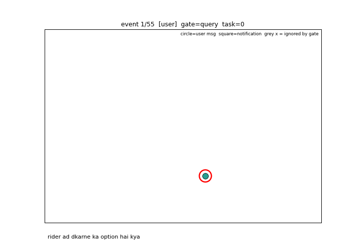


**Full write-up:** [`report/report.html`](report/report.html) / [`report/report.pdf`](report/report.pdf) — dataset, architecture, every result table and figure, qualitative error analysis.

## Headline results

| | R@1 | 95% CI |
|---|---|---|
| naive RAG (latest message only) | 0.605 | 0.569–0.642 |
| naive RAG (last-4 concat) | 0.253 | 0.227–0.278 |
| **DCGR (full)** | **0.783** | **0.752–0.815** |

- Best embedder tried: **Qwen3-Embedding-4B**, dense retrieval → **R@1 = 0.852**.
- Best LLM-assisted config: **Phi-3.5-mini-instruct** used as a *selective* resolver (only on ambiguous turns) → **R@1 = 0.793**, for ~169 extra generations over ~1,770 test events.
- Cross-encoder reranking and full per-turn LLM query rewriting both make things **worse** here — see the report for why.
- Generic embedding-similarity clustering caps at ARI≈0.26 for recovering conversational task boundaries; DCGR's family-aware assignment reaches ARI=0.798.

## Repo layout

```
data/            synthetic KB (181 docs) + event log (5,135 events, 160 users) + embedding/LLM caches
src/             pipeline implementation (see below)
scripts/         entry points: download models, run experiments, make figures, analyze errors, animate
results/         *.json metrics from every experiment stage (see Results section)
figures/         *.png charts used in the report
animations/      interactive HTML replay + GIF of the pipeline running on a real test user
report/          report.html / report.pdf — the full write-up
```

**`src/` modules:**
- `gen_data.py` — synthetic KB + conversation generator
- `kb.py`, `common.py` — KB schema, data loaders, product lexicon
- `embedders.py` — 7 pluggable embedding back-ends (TF-IDF → Qwen3-Embedding-4B), disk-cached
- `retrieval.py` — BM25, dense cosine, hybrid fusion (RRF / weighted), cross-encoder rerank, ranking metrics
- `pipeline.py` — the DCGR pipeline itself (gate → tasks → constraints → notif-linking → query builder → search), fully ablatable via `Config`
- `llm.py` — local LLM wrapper (4-bit quantized) for query rewriting / selective resolution
- `noise.py` — interruption injector for the robustness stress-test
- `cluster_study.py` — task-clustering benchmark (generic methods vs. DCGR)
- `evaluate.py` — experiment harness (metrics, gate precision/recall, task ARI, latency)
- `animate.py` — builds the interactive demo + GIF

## Quickstart

```bash
# 1. install deps: torch (cuda), transformers, sentence-transformers, scikit-learn,
#    numpy, matplotlib, huggingface_hub, bitsandbytes (for 4-bit local LLMs)

# 2. download all models used in the study (~37GB; skip ones you don't need in scripts/download_models.py)
python3 scripts/download_models.py

# 3. run every experiment stage (resumable — reruns only stages missing a results/*.json)
python3 scripts/run_experiments.py
#    or a subset:
python3 scripts/run_experiments.py embed search context ablation noise llm cluster bootstrap --force

# 4. regenerate all report figures from results/*.json
python3 scripts/make_figures.py

# 5. qualitative error dump for the full DCGR config
python3 scripts/analyze_errors.py

# 6. build the interactive pipeline-replay demo + task-clustering GIF
python3 src/animate.py --gif
```

## Results

Each stage writes one JSON file to `results/`:

| File | What it covers |
|---|---|
| `embed.json` | 7 embedders × 4 search strategies |
| `search.json` | search-strategy comparison (± cross-encoder rerank), DCGR context vs. naive |
| `context.json` | 6 ways to build the query (naive concat/history → DCGR structured → oracle) |
| `ablation.json` | each DCGR layer removed one at a time |
| `noise.json` | robustness to 0–3× injected interruption events |
| `llm.json` | 5 local LLMs × 3 usage strategies (full rewrite / rewrite+gate / selective resolver) |
| `cluster.json` | generic clustering methods vs. DCGR task assignment, val-tuned/test-scored |
| `bootstrap.json` | 2,000-resample 95% CIs for the headline systems |

### Figures

**Dataset & architecture**

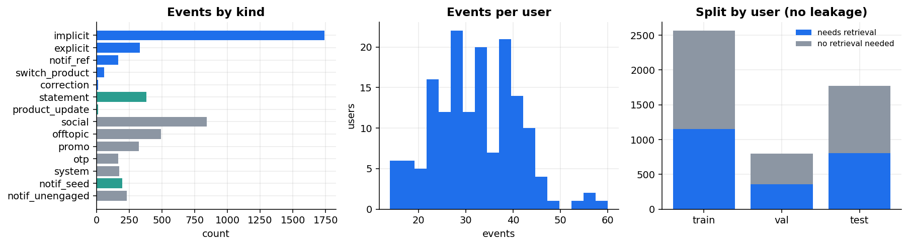
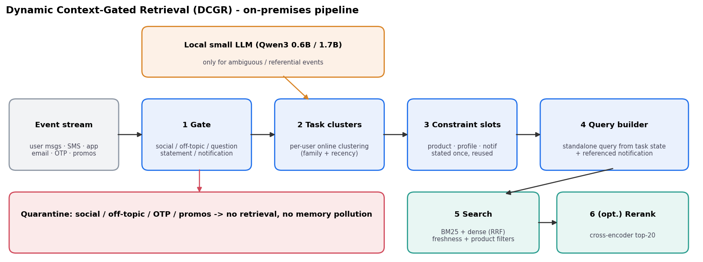

**Embedding model comparison — 7 embedders × 4 search strategies**

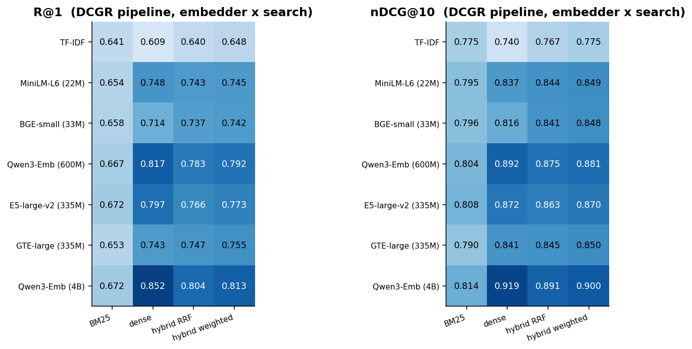

**Search strategy — BM25 / dense / hybrid, ± cross-encoder rerank**

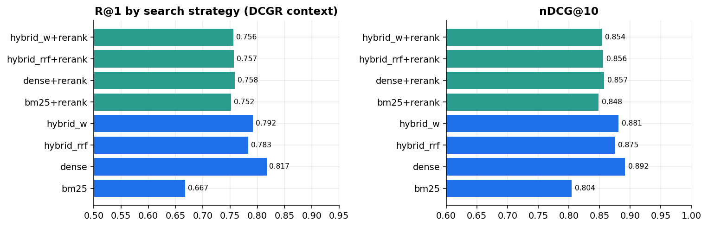

**Query construction — 6 ways to build the search query**

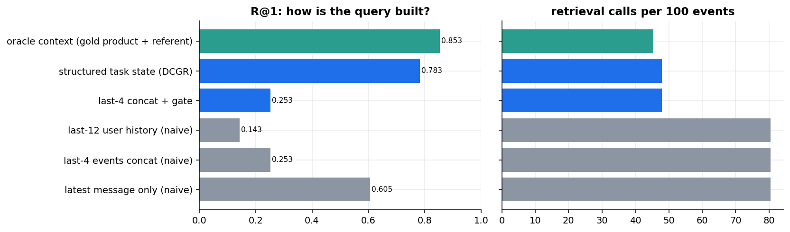

**Layer-by-layer ablation**

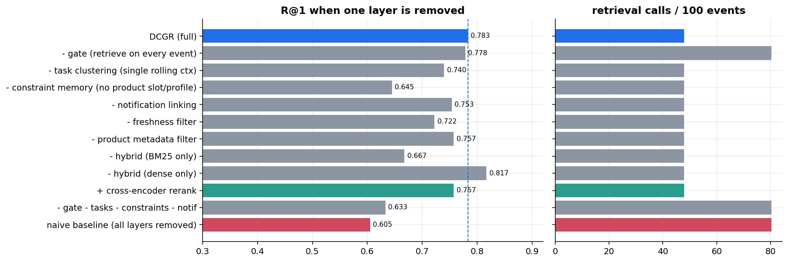

**Robustness to injected interruption noise**

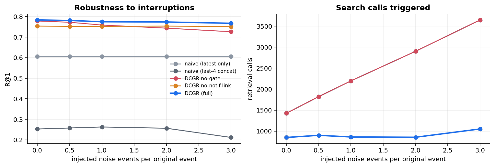

**Task recovery — generic clustering vs. DCGR**

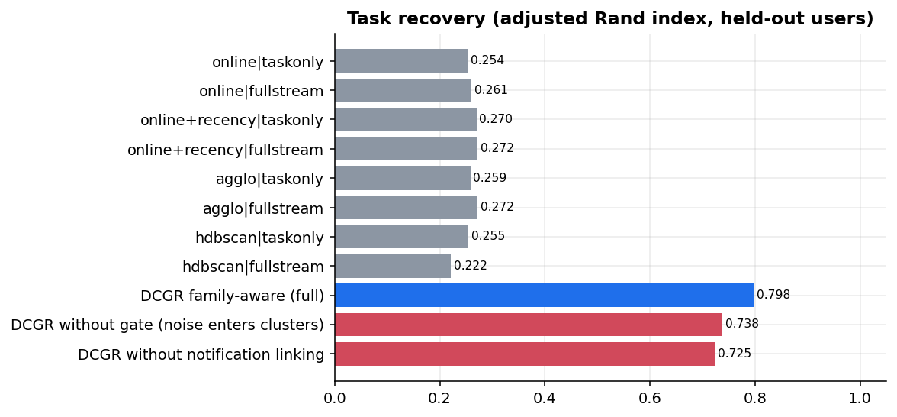

**Where structure helps most, by question type**

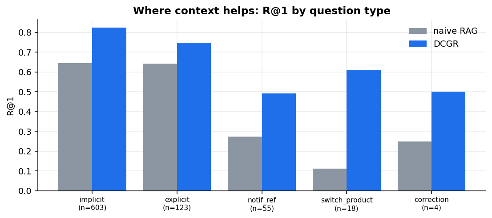

**Local LLMs as query resolvers — 5 models × 3 strategies**

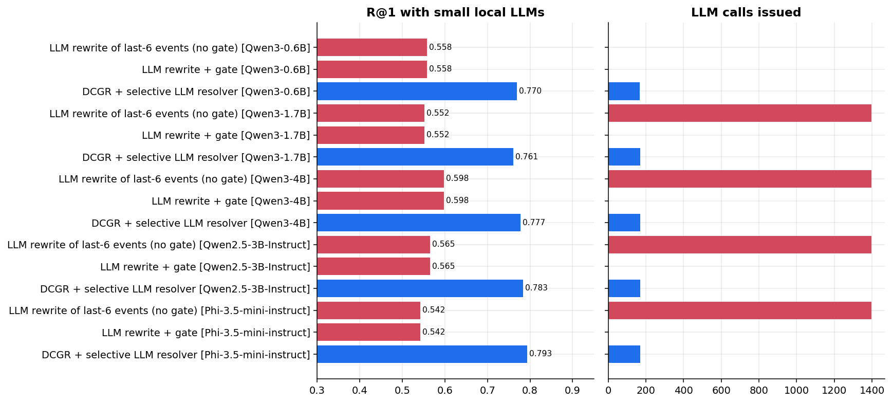


## Notes

- All models run **fully on-premises** (local weights, no API calls); local LLMs are loaded 4-bit (NF4) quantized.
- Everything is reproducible from `data/events.jsonl` + `data/kb.jsonl`; embedding/LLM outputs are disk-cached by content hash in `data/emb_cache/` and `data/llm_cache/` so reruns are cheap.
- Every number in the report comes straight from `results/*.json` — see `report/report.html` for the full analysis, figures, and qualitative error breakdown.
